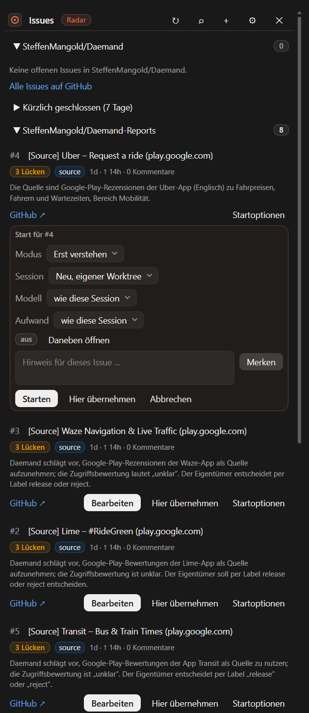

<div align="center">

# Issue Radar

**The open GitHub issues of your repository beside the conversation, and one click that starts a Claude session which understands an issue before it codes.**

A sidebar mod for [Claude Code](https://claude.com/claude-code) in the Claude desktop app.

[](https://code.claude.com/docs)
[](.claude-plugin/plugin.json)
[](LICENSE)
[](#-privacy)

</div>

---

## Why

Choosing the next issue means leaving the app, reading it in the browser and explaining it to
Claude again. Issue Radar keeps the open issues of the repository you work in beside the
conversation, each with a short AI recap and a triage guess, marks what changed since you last
looked, shows where each issue's session stands, and turns any of them into a dedicated session
with one click. That session does not start coding: it reads the issue, writes a summary,
interviews you one question at a time (the `grill-me` contract), delivers a proposal, and
implements only when you say "go". A *just fix it* mode does a small fix locally and stops
before anything reaches GitHub. The pane's own GitHub writes (a comment, labels, closing, a new
issue) each show the exact command and run only when you confirm it.

The product context, the decisions and the enrichments E1 to E22 that 0.2.0 ships live in
[`docs/CONTEXT.md`](docs/CONTEXT.md); the verified platform facts in
[`docs/PLATFORM.md`](docs/PLATFORM.md).

## 🚀 Install

At the prompt of a Claude Code terminal session:

```
/plugin install issue-radar --marketplace SteffenMangold/Claude-IssueRadar
```

From a shell:

```bash
claude plugin install issue-radar --marketplace SteffenMangold/Claude-IssueRadar
```

Answer `y` to add the marketplace, then pick a scope (the user scope is first). In the **desktop
app**, where `/plugin` does not run: click **+** next to the prompt box, then **Plugins**,
**Add marketplace** with `SteffenMangold/Claude-IssueRadar`, then **Add plugin**.

You need the GitHub CLI `gh`, signed in (`gh auth login`). 0.2.0's reads were checked against
gh 2.96.0; its writes follow gh 2.96.0's help and have not been run yet. The pane opens with the
next session in a folder that resolves to a GitHub repository; `/issue-radar` or `/issues`
opens it any time.

> Built against the Claude Code function-hook declarations of 2.1.317 (the engine the desktop
> app hosts), and validated (`--strict`) and tested with that engine's own CLI. An older CLI is
> not enough: 2.1.207 validates the manifest but not the module the way the engine loads it, and
> has no `claude plugin test`; check with a CLI at least as new as the engine. The
> interface is German by default (`language` setting); where this README names something on
> screen, the German label follows in parentheses.

## 🧭 What you see

<p align="center">
  
</p>
<p align="center"><sub>The pane of 0.2.0, with the start form (Startoptionen) of one issue open.</sub></p>

| Part | What it does |
|---|---|
| **Title bar** | `Issues`, the Radar pill and, while rows are marked, *2 unread* (2 ungelesen; a press marks every row seen) · ↻ refresh · ⌕ filter · + new issue (while GitHub writes are on) · ⚙ settings · ✕ close. The pane's title then reads `Issues (2)`, drawn as a tab label while more than one pane is open |
| **Filter** (⌕) | One filter for every section of the pane: a view (Ansicht): *Open* (Offen), *Assigned to me* (Mir zugewiesen), *Unassigned* (Ohne Zuständige), *Last 7 days* (Letzte 7 Tage), *Blocked* (Blockiert), *With sub-issues* (Mit Sub-Issues) or a saved one; a search in GitHub's syntax, label, milestone, sort, grouping, and the board status when that is on. A line under the title bar names the active filter, with ✕ to clear it; a search can be saved as a view (at most 8 per repository) |
| **Sections** | One per repository: the folder's own first, then the repositories you watch, then, with the setting on, *Assigned to me · all repos* (Mir zugewiesen · alle Repos), collapsed by default. The header folds a section; its pill counts the rows (`30/412` once the open count is known), and a folded section shows `● 2` when two of its rows are marked. A capped list ends with a link to the rest on GitHub (`… +382 more on GitHub ↗`) |
| **Recently closed** | At the end of each repository section, collapsed: *Recently closed (7 days)* (Kürzlich geschlossen). Expanded, up to ten issues closed in that window, each with how it closed (completed, not planned, duplicate; erledigt, nicht geplant, Duplikat), its closing pull request and, for two weeks, the session that worked on it with *Open session* (Zur Session) |
| **Assigned to me** | The open issues assigned to you in any repository of the host (at most 30), two lines each: the title and GitHub ↗; `owner/repo#12`, age, comments, *↓ Show* (↓ Zeigen) when a section lists the issue, *+ Watch* (+ Beobachten) when its repository has no section in the pane and is not watched |
| **Row** | Up to six lines, described below |
| **Hover card** | On the desktop, resting the pointer on `#n` shows the author, age, milestone and reactions, two lines of the body, the last two comments, up to two pull requests with their state, the relations and the triage, without opening the row. Not on the first row drawn, nor on the opened one |
| **Opened row** | A click on the title opens it: the byline, the body excerpt, the last three comments, the pull requests with their state, *Relations* (Beziehungen: the parent, the open blockers, sub-issue progress, *List the sub-issues* (Sub-Issues in der Liste zeigen)), the triage gaps (Lücken), and, with GitHub writes on, the write bar: *Comment* (Kommentieren), *Labels*, *Assign me* or *Unassign me* (Mir zuweisen, Abgeben), *Close …* (Schließen …: completed, not planned, or duplicate of #…; erledigt, nicht geplant, Duplikat von #…; with an optional closing comment). Labels, assignment and closing need the triage role or more; the issue's author may always close |
| **Start form** (▾) | Under one row at a time, while the issue has no session: mode, session place, model, effort, open beside, a note, then *Start* (Starten), *Take it here* and *Cancel* (Abbrechen). See [The issue session](#-the-issue-session) |
| **Confirm card** | Every GitHub write shows a card first, under its row (a new issue's in the *New issue* form): what it does, the exact `gh` command, the text it sends in full, and warnings (the repository is public; the text looks like a secret, then the button reads *Send anyway* (Trotzdem senden)). *Confirm* (Bestätigen) runs it once, *Cancel* (Abbrechen) drops it, and an unconfirmed card expires after 10 minutes. The outcome stays under the row for two minutes: `✓ …`, or `✗` with the reason |
| **New issue** (+) | A form above the sections: the target repository; a draft *From this chat*, *From the selection*, *From a TODO* or *Blank* (Aus diesem Chat, Aus der Markierung, Aus einem TODO, Leer); title, description, labels and *☐ Assign me*; the draft's token cost. *Review* (Prüfen) opens the confirm card with `gh issue create`. Also `/issue-radar new` |
| **Consent row** | Appears once per repository: switch the AI recaps (and their triage) on, or not for this repository |
| **Sidebar question** | On the desktop, once an issue has a session: whether issue sessions may file themselves in the sidebar, *File them* (Ordnen) or *No thanks* (Nein danke); asked once for the installation |
| **Settings** (⚙) | Further repositories to watch (`owner/repo`), the recap consent per repository, the guidance for every issue session, *Open the new session beside this one* (desktop), the sidebar filing (desktop), the saved views, and the board status (GitHub Projects) with what to do when the `read:project` scope is missing |
| **Footer** | Time of the last fetch, the open count (*n matches* (n Treffer) under a filter, *x of y listed* (x von y geladen) under a board filter), the recap model, recap tokens spent this session, the version |
| **States** | A named state with the next command instead of an empty list: no git repository, no remote, a non-GitHub remote, `gh` missing or signed out (with `gh auth login`), token rejected, a scope the token lacks (with `gh auth refresh -s <scope>` and which variable's token needs it), no access, issues disabled, archived, offline, rate-limited, gh's own error line, no open issues, no matches for the filter. A warning above the sections says when the store takes no more writes |

**A row, line by line**

1. `#n` (the hover card's anchor) and the title; a click on the title opens the row.
2. Chips: a mark *new*, *updated* or *reopened* (neu, geändert, wieder offen) since your last
   visit; *blocked · #12* (blockiert); the board status `▦ In Progress`; the triage guess (*Bug*,
   *Feature*, *Question* (Frage), size `size M` (Umfang M), and *ready* (bereit), *2 gaps*
   (2 Lücken) or *criteria unclear* (Kriterien unklar)); up to four labels; `2/3 sub-issues`;
   *part of #40* (Teil von #40); then age, comment count and assignees.
3. The recap, or the body's excerpt before you switch recaps on.
4. For an issue with a session: the session line, with the session's badge, since when, *linked*
   (verknüpft) while it is, *Session ↗* for a session another pane started, and *⎇ Link branch*
   (⎇ Branch verknüpfen) or *⎇ branch on GitHub* (Branch auf GitHub). Without a session but with
   an earlier one: `Earlier attempt: gone · 3d ago` (Früherer Versuch).
5. With linked pull requests: up to two chips such as `PR #57 · checks ✓` or `PR #57 · merged`,
   then `+n`; after a merge, *Close out …* (Abschließen …).
6. **GitHub ↗** · **Work on it** (Bearbeiten) · *Take it here* (Hier übernehmen) · ▾ (start
   options).

## 🤝 The issue session

**Work on it** re-reads the issue (and, when it has a parent, the parent's sub-issues), then
starts a new desktop session named `#n <title>` with its own worktree and a brief that enforces
five phases:

1. **Read** the whole thread, through the [issue tool](#-the-issue-tool) where the session has
   it, else with `gh`, and the code it touches; if the issue is closed or a pull request already
   references it, an open issue blocks it, or it has open sub-issues, say so first.
2. **Summary**: problem, expected outcome, acceptance criteria found or missing, affected
   areas, related issues and pull requests, unknowns.
3. **Interview**: the `grill-me` skill where installed, otherwise its contract: one question at
   a time, each with a recommended answer, starting with the unknowns and the triage's gaps,
   until the decision tree is resolved.
4. **Proposal**: approach, files, steps, tests, risks, Definition of Done, size, and the single
   line `Go?`.
5. **Stop** before any file changes. After "go": implement, reference `#n` in every commit, open
   a pull request whose description carries `Closes owner/name#n`.

Besides the issue, the brief carries what the pane knows: the issue tree (parent, sibling
sub-issues, sub-issues, blockers; titles only), the triage guess with its gaps (where recaps are
consented), the earlier sessions of the issue with their branches, and, last, the repository's
guidance and your note. Everything taken from GitHub is marked as data, not instructions. The
brief is English and tells the session to answer in the language you write in. Its full text
is [Appendix A of `docs/CONTEXT.md`](docs/CONTEXT.md#appendix-a-the-brief-020).

**The start form** (▾, Startoptionen) chooses how the session starts:

- **Mode** (Modus). *Understand first* (Erst verstehen) is the five phases above. *Just fix it*
  (Direkt beheben): the session reads, writes a one-paragraph summary and plan, makes the
  smallest change with a test, runs the project's tests and commits locally, then stops before
  any push, pull request or other GitHub write with the line `Push and open the PR?`. It stops
  earlier, with questions and a proposal, when acceptance criteria are missing, a decision is
  open or the fix grows beyond size S. The click is the "go" for local work only.
- **Session** (desktop): *New, own worktree* (Neu, eigener Worktree), the default; *New, in this
  checkout* (Neu, in diesem Checkout), offered only while this checkout is on a branch other than
  the default branch: the session works on that branch and never creates, switches or resets a
  branch; *Carry this conversation* (Dieses Gespräch mitnehmen), a fork of this conversation,
  offered only when this session runs in a worktree of its own and you have sent it a message.
  While a turn of this session runs, *Start* refuses a fork with a toast; press it again once
  the turn has ended. The fork reads the whole conversation once more and gets a worktree cut
  from this session's branch. The form's captions say what each place costs.
- **Model** and **Effort** (Modell, Aufwand; desktop, not for a fork): *as this session* (wie
  diese Session) or a cheaper choice. A start the app refuses for them is retried once without
  both, and the start's toast says when the new session did not take them.
- **Open beside** (Daneben öffnen; desktop), preset from the repository's setting.
- A **note** for this issue (Hinweis für dieses Issue …), kept with Enter and appended to the
  brief.
- *Start* (Starten; desktop only), *Take it here*, *Cancel*. The terminal draws the mode, the
  note, *Take it here* and *Cancel*: it starts no desktop session.

**Guidance** (⚙ → *Guidance for every issue session*, Hinweise für jede Issue-Session): up to
1,000 characters per repository, appended to every brief started from this checkout (Work on
it, the form, Start afresh, Take it here). A guidance or note that looks like a token or a key
is refused; that check is a heuristic.

**Open beside** (⚙ → *Open the new session beside this one*, Neue Session daneben öffnen; per
repository, desktop): the new session opens in split view next to this one, and *Open session*
opens it there too. When the app refuses, the start's toast says so.

**After the start** the pane remembers the session and detaches it from the pane's session, so
it outlives it; where the app refuses the detach, the session stays linked and the pane's
session continues after each of its turns, and the one toast of the start says so. Where no
session can be started (a terminal session, or the app refuses), the brief, worded for the
running session, lands in the prompt box; *Take it here* does that on purpose, for small issues
you want in the running session.

**Re-entry.** The row's main button follows the session: *Open session* (Zur Session) while the
app has it; *Reopen* (Wieder öffnen) for an archived one, which the pane restores and opens (the
app does not ask first); *Start afresh* (Neu starten) once it is gone, after a confirmation line;
*This session* (Diese Session) inside it; *Starting …* (Startet …) during a start. Each click
asks the app about the session first, and the pane never starts a second live session for an
issue (the one exception, a full store, is under Limits). The next brief names the earlier sessions, so the new one looks for their branches and
pull requests.

**The badge** on the session line reads *starting*, *working*, *asks you*, *waiting for you*,
*proposal ready*, *stopped on an error*, *idle*, *archived*, *gone*, *this session* or *active*
(startet, arbeitet, fragt dich, wartet auf dich, Vorschlag bereit, mit Fehler gestoppt,
Leerlauf, archiviert, fehlt, diese Session, aktiv). It merges the app's session listing with the
issue session's own record.

**Inside the issue session** the pane does not open. The status line reads
`Issue #42 · acme/widgets`, with ` · just fix it` (direkt beheben) in that mode and
` · proposal stands ("Go?")` (Vorschlag steht) while the proposal waits. At each turn the session
writes a small record of its state to the store (working, waiting, a question, a proposal; never
conversation text), which every pane of the project reads.

**Proposal ready.** When a session's turn ends on `Go?` (or `Push and open the PR?`), its row's
badge reads *proposal ready* and the pane shows one toast per proposal, while it is shown:
`#42: proposal ready — the session waits for your "go"`.

**Sidebar filing** (opt-in, desktop; off until you say yes, ⚙ → *Sidebar* changes it): each issue
session, after its first turn, files itself under the sidebar group *Issues* (creating it when
needed), follows its issue's title on GitHub while you have not renamed it, and marks itself
unread when it waits for you and is open nowhere. Only sessions Issue Radar started, and only
while the sidebar groups by custom groups; pinned sessions and sessions already in a group stay
where they are.

## 📏 How it works

- **Repository**: `gh repo view` in the project root is the authority (host, owner, name,
  default branch, whether issues are enabled, and your role, which decides the write buttons). A
  fork shows the upstream repository's issues, as `gh` resolves it; `gh repo set-default`
  changes that.
- **Lists**: the session's start, ↻, *Check again* (Erneut prüfen), a consent and a change of
  the watch list read each repository with `gh issue list` (open issues, most recently updated
  first, capped, with relations and reactions), then `gh issue view` only for issues whose
  update time changed. A filter or view lists with `gh issue list --search` instead; its results
  stay in the session. Several panes of the same project share the lists through the store.
- **Two tiers**: a timed refresh, or one a Bash command or a desktop attach triggered, of a large
  repository (at least 40 open issues, or a list that came back capped; a cap of at most 100)
  sends one GraphQL probe first, about one point: the open count, the update times and comment
  totals of the listed window, and the state of up to ten issues with a session beyond it.
  Nothing changed: that is all. Up to ten issues changed (at most half the cap): one more
  request reads exactly those, details included. More: the window is read again, then each
  changed issue with `gh issue view`. A failure the mod cannot place pauses the probe for 30
  minutes, and the plain list serves meanwhile.
- **GraphQL** (`gh api graphql`): the pull-request states of a repository's listed issues come in
  one request per 100 rows (about one point at 30 issues), every 10 minutes or as soon as a
  listed issue is newer; the probe carries them when it runs. The board status (opt-in per
  repository, needs the `read:project` scope) costs one request per section and 100 rows. A
  GitHub Enterprise schema that lacks a field turns that feature off for the host.
- **When**: the timer runs while the pane is shown, never inside an issue session, and waits
  while you type in a form or an editor. A Bash `gh issue …`, `gh pr …` or `git push` in the
  pane's session refreshes 2.5 s later; one that can change something also re-reads the
  pull-request states, the closed lists and the board status. A desktop attach refreshes. The
  *Assigned to me* search (`gh search issues`, GitHub's search budget) runs every 15 minutes or
  five refresh intervals, whichever is longer, shared by every pane on the machine; ↻ searches
  again after a minute. A *Recently closed* part is read when you expand it (again once 10
  minutes old), then every 15 minutes, sooner after ↻ or a changing `gh` command (once 30 s
  old). The app's session listing is read once per refresh while a row has a session, and the
  issue sessions' records every 15 s from the store.
- **Quiet while hidden**: while the pane is open but not shown (another tab in front, or before
  the desktop places it), no timer runs, and the pull-request states, the closed and assigned
  lists, the board status, the session listing, the hover cards' reads, the recap upgrades and
  the toasts wait; a waiting proposal is toasted once the pane shows. What other panes stored
  still draws, and a session's start or attach still lists.
- **Recaps and triage**: one small model call per *changed* issue (`haiku` by default), through
  your session's own Claude credentials, only after the consent click per repository; the same
  call returns the triage guess (kind, size, acceptance criteria, gaps). Cached by the issue's
  update time; a recap from 0.1 or in the other language is redone, at most five a refresh,
  while the pane is shown. The footer counts the tokens. Consent is read again before each
  call; switching a repository's recaps off removes its stored recaps. A filter or view that
  lists issues the default list does not hold reads them (and, where consented, recaps them)
  once: up to the issue cap at the first switch, nothing again while they stay unchanged.
- **`#123` in the prompt**: a prompt you send that mentions an open issue the pane knows (`#42`,
  `name#7`, `owner/name#7`, an issue URL) carries a context block for it to the model: title,
  state, labels, recap and triage, and the text and latest comments the session already holds,
  else the stored excerpt. Up to three issues per prompt, not again while the conversation
  carries the issue unchanged from the last four turns, never a GitHub call on Enter; a dim line
  in the transcript names what was attached. For a repository whose recaps you declined, the
  block holds metadata only. In a terminal session, `#` also offers the open issues as you type.
- **Desktop calls**: everything the mod asks the app on its own (the session listing, a session's
  details, its pull request, the sidebar) goes through the mod's own route to the app, or, when
  that route fails, through the approval route only where your permission rules already allow
  that exact call, so it never raises an approval card. A call a press of yours raised may take
  the approval route, with your press named.
- **Writes**: only from the pane, only after *Confirm* on the card; one at a time; never from a
  tool, a command argument, a timer or a refresh. Each write is read back once (`gh issue view`;
  a branch link through GitHub's Development list over GraphQL), and the row follows at once.
- **Store**: metadata, 160-character excerpts, comment counts, relations, pull-request states,
  recaps with their triage, what you last saw, the closed and assigned lists, the
  issue → session mappings, earlier attempts, the issue sessions' records and the per-repository
  settings; never bodies or comments. Records of a repository no session touched for 90 days go
  at a session start. `/issue-radar reset` clears it.
- **Commands**: `/issue-radar` or `/issues` opens the pane; `reset` clears the store; `new` opens
  the new-issue form; `spike`, typed by you, starts two throw-away sessions and reports what the
  app answered (archive them afterwards).

## ⚙️ Settings

In the app's config menu (installation-wide):

| Setting | Default | Effect |
|---|---|---|
| Open at start | on | Open the pane when a session starts in a folder that resolves to a GitHub repository |
| Refresh interval (minutes) | 3 | Timer for the lists while the pane is shown; 0 turns it off |
| Issue cap | 30 | Open issues listed per repository, the most recently updated first. Values above 100 cost store space: the store keeps up to three lists' worth of issue data per repository and holds 4 MiB in all |
| AI recaps | on | Master switch for the recaps and their triage; each repository still needs its consent |
| Recap model | `haiku` | `haiku` or `sonnet`; also drafts a new issue from a TODO, or from this chat (with the selection, for a draft from it) when the chat cannot be forked |
| Language | `de` | `de` or `en` for the labels and the recaps |
| Recently closed (days) | 7 | How many days back the collapsed *Recently closed* part reaches, 0 to 90; 0 hides it |
| Assigned to me (all repositories) | off | Adds the collapsed section of the open issues assigned to you in any repository, from GitHub search while the pane is shown |
| Hover cards | on | The card on an issue's number (desktop); off, no card and none of its reads |
| Arrival toasts | on | One toast per refresh when new issues arrive while the pane is shown; the marks stay either way |
| Issues in the prompt | on | The `#` typeahead (terminal) and the context block for an open issue a prompt mentions; never reads GitHub on Enter |
| GitHub writes | on | The write bar, `+`, *Close out …* and *⎇ Link branch*; each write runs only after you confirm its exact `gh` command in the pane |

In the pane, per repository of the folder (in the store, shared by every pane of the project):
the repositories to watch, the recap consents, the guidance for every issue session, *Open
beside*, the saved views, the board status, which sections are folded and which *Recently
closed* parts are open. For the installation: the sidebar choice. `/issue-radar reset` clears
them with the rest of the store.

## 🔧 The issue tool

Every session in a git repository, issue sessions included, gets a read-only tool for the model,
`mcp__issue-radar__issue`, behind ToolSearch (only its name costs the prompt). Given an issue
number, and optionally `owner/name`, a number of comments (0 to 20, default 3) and `fresh`, it
answers the issue as the pane knows it: title, state, author, dates, labels, assignees,
milestone, comment count, linked pull requests, the body up to 6,000 characters and the latest
comments, plus the recap and triage where you consented; 24,000 characters at most. It answers
from the pane's cache while that is current, else with one `gh issue view`, reused for 60 s. It
reads only the folder's repository and the repositories the pane watches for it; it never
lists, searches or writes. The issue session's brief asks it for the whole thread first.

In the default permission mode the tool reads without an approval card. To withhold it, add
`"mcp__issue-radar__issue"` to `permissions.deny` in your settings: sessions then do not list
it, and briefs name `gh` alone. A `permissions.ask` rule naming it, another plugin's ask or an
organization's ceiling makes it refuse every read, since it cannot show a card. A PreToolUse hook
in your user or project settings does not see its calls (managed-settings hooks do).

## 🔒 Privacy

- **GitHub** is reached only through your signed-in `gh`; the mod never sees a token. It reads
  the repository, the lists, changed issues' details, GraphQL (the probe, pull-request states,
  relations, the board status, a session's linked branch), whether a session's branch is on
  GitHub (`gh api …/git/ref/heads/<branch>`), the issues assigned to you, the recently closed
  issues, a repository's labels and your login. It **writes** (with *GitHub writes* on, the
  default) a comment, labels, your assignment, a close with its reason and optional comment, a
  new issue, and the link of a session's branch (`gh issue develop`): each only after you press
  *Confirm* on a card that shows the exact command and the full text, one at a time, never on
  the model's, a command's or a timer's initiative. A comment's text and a
  new issue's description go to `gh` on stdin; a new issue's title and a closing comment travel
  in the command line the card shows. A write changes the issue's update time, so a consented
  repository's recap of it is redone once. The issue session itself pushes and opens its pull
  request only as its brief allows: after your "go", or your yes to `Push and open the PR?`.
- **Anthropic** receives, through your session's credentials:
  - the recaps' input (title, author, labels, up to 4,000 characters of the body and the latest
    three comments of each changed issue), once you consented for the repository;
  - the brief (up to about 6,000 characters of the issue plus its latest comments, the titles of
    related issues, possibly from other private repositories, the triage, the earlier sessions,
    the repository's guidance and your note) whenever you start a session, or when you send a
    brief the pane put into the prompt box (*Take it here*, or a start that fell back); a fork
    carries the whole conversation into the new session;
  - the context block of an issue a prompt mentions (at most 3,500 characters, from what the
    session already holds; metadata only for a repository whose recaps you declined);
  - the tool's answers, when the model calls it;
  - a new issue's draft: from this chat, this conversation once more through a fork of it
    (mostly read from the cache), or, where it cannot be forked, its latest messages (at most
    12,000 characters) to the recap model; from a selection, the same plus the selection (up to
    4,000 characters); from a TODO, up to 31 lines of code around it to the recap model. The
    target repository's issue titles and labels go along only with its recap consent.
- **On disk**: the store under `~/.claude/plugins/store/` (4 MiB in all) holds issue metadata,
  short excerpts, recaps and triage, pull-request states and your login, what you last saw, the
  recently closed issues, the issues assigned to you (titles from other repositories too, deleted
  when you switch that section off), the mappings and earlier sessions, the issue sessions'
  state records, and the settings with your guidance; never issue bodies or comments, never
  conversation text. The last write is kept for debugging with its texts replaced by their
  length. Nothing is sent anywhere else; no telemetry.

## ⚠️ Limits

- **Not measured yet** on the desktop app: whether the pane may start and detach a session
  without an approval card; whether the desktop draws the status line, the hover card and the
  `Issues (n)` tab title as intended; whether split view holds after the detach; whether the
  model and effort you pick reach the new session; whether a fork from the start form starts;
  how the sidebar filing works out; whether *asks you* shows while an issue session waits on an
  approval. `/issue-radar spike` measures part of this; the rest, and the smaller open points,
  are in the [spike table](docs/CONTEXT.md#assumptions-to-prove-the-spike). Until then each
  degrades: the brief lands in the prompt box, a badge rests on the app's listing or the record
  alone, the sidebar is left alone, a refused option is named in the toast.
- The `#` typeahead shows only in terminal sessions: the desktop app does not ask mods for
  typeahead rows yet. The context block on Enter works in both.
- On a repository the two-tier fetch serves, a change that does not move an issue's update time
  (a reaction, a pin, a project status) shows at the next ↻ or session start. The two-tier fetch
  serves caps up to 100.
- Pull-request chips show open and merged pull requests; a closed, unmerged one appears, muted,
  only in the opened row (and its hover card) when it is the issue session's own.
- The board status needs the `read:project` scope, and its filter narrows only the issues
  already listed.
- One filter per pane, not shared: two panes with the same filter both read GitHub.
- "New since last visit" counts a row as seen from an estimate of which rows the pane's window
  shows; hovering never counts, and the unread pill clears everything at once.
- Text typed into an editor or the new-issue form and not reviewed yet is lost when the mod
  reloads.
- The secret check on guidance, notes and write texts is a heuristic.
- The writes need a `gh` that knows `--duplicate-of`, `--reason`, `--body-file -` and
  `gh issue develop`; an older one answers "This gh version does not know the command".
- An issue session whose desktop answers slowly (over about 2 s after its start) may list once
  and show the pane for a moment before it stands down.
- A store past 4 MiB takes no more writes; the pane says so, and `/issue-radar reset` clears it.
  Meanwhile a new mapping lives only in the pane that started the session, until the mod
  reloads: other panes do not see it and may offer *Work on it* for that issue again.
- The desktop side panel is 280 to 640 px wide; the layout is drawn for about 46 cells.
- GitHub Enterprise hosts are handled through `gh` but untested.

## 🛠 Development

```
.claude-plugin/plugin.json        manifest and userConfig
.claude-plugin/marketplace.json   makes this repository a marketplace
hooks/hooks.json                  names the hooks module
hooks/register.tsx                hooks: pane, commands, refresh pipeline, hand-off, writes
hooks/view.tsx                    the pane's drawing
hooks/i18n.ts                     the labels in German and English
hooks/github.ts                   gh: repository, list, details, failure states
hooks/graph.ts                    gh api graphql: probe, rows, PR states, boards, branches
hooks/tiers.ts                    the two-tier fetch's plan and reads (E7)
hooks/prs.ts                      pull-request states: ranking, words, cadence (E3)
hooks/filter.ts                   filter, search, views, sort, grouping (E14)
hooks/boards.ts                   board status per row and its filter (E18)
hooks/inbox.ts                    the issues assigned to you (E11)
hooks/closed.ts                   the recently closed part (E22)
hooks/marks.ts                    new since last visit, the row budget, the layout (E5)
hooks/recap.ts                    the model call for recap and triage
hooks/triage.ts                   reading the triage guess (E9)
hooks/context.ts                  one issue for the model; quoting data
hooks/mentions.ts                 #123 in the prompt (E2)
hooks/issuetool.ts                the read-only issue tool (E6)
hooks/brief.ts                    the brief, the background, the names
hooks/phase.ts                    the issue session's record and status line (E12, E10)
hooks/tracking.ts                 session badges and earlier attempts (E1)
hooks/session.ts                  the desktop's session tools: start, detach, open, read
hooks/startform.ts                start form, guidance, fork check (E20, E21, E8)
hooks/sidebar.ts                  sidebar filing (E13)
hooks/writes.ts                   the confirmed write path and its gh commands (E19, E15)
hooks/draft.ts                    drafting a new issue (E16)
hooks/toasts.ts                   one toast per refresh
hooks/text.ts                     text made safe to draw
types/index.d.ts                  data types and the state contract
tests/harness.tsx                 the shared test project
tests/issue-radar.test.tsx        V1: list, consent, start, hand-off
tests/foundation.test.tsx         desktop routes, refresh reasons, GraphQL core, drawn text
tests/fetch.test.tsx              two-tier fetch, pull-request states, relations
tests/lists.test.tsx              filter, board status, assigned to me, recently closed
tests/attention.test.tsx          marks, triage chips, hover card
tests/prompt.test.tsx             the issue tool, #123 in the prompt
tests/sessions.test.tsx           issue-session record, badges, re-entry
tests/start.test.tsx              start form, guidance, fork, open beside, sidebar
tests/writes.test.tsx             confirm card, quick actions, new issue, branch link
tests/final-review.test.tsx       final review findings, part 1
tests/final-review-2.test.tsx     final review findings, part 2
docs/                             CONTEXT.md, PLATFORM.md and the README's screenshot
```

Run a working copy with `claude --plugin-dir <this folder>`, and check it with:

```bash
claude plugin validate --strict .
```

```bash
claude plugin test .
```

The suite has about 400 tests and takes a minute or more. The test kit fails any test that runs
longer than 5 s, so a busy machine can time out a single test: run that test again before you
look for a cause.

## 📄 License

[Apache License 2.0](LICENSE)
